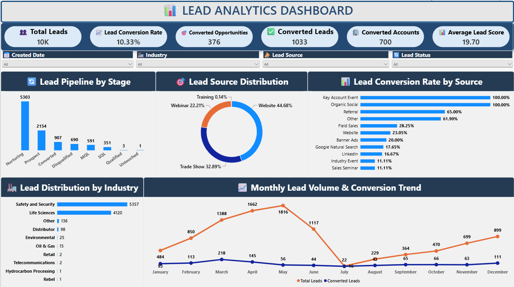
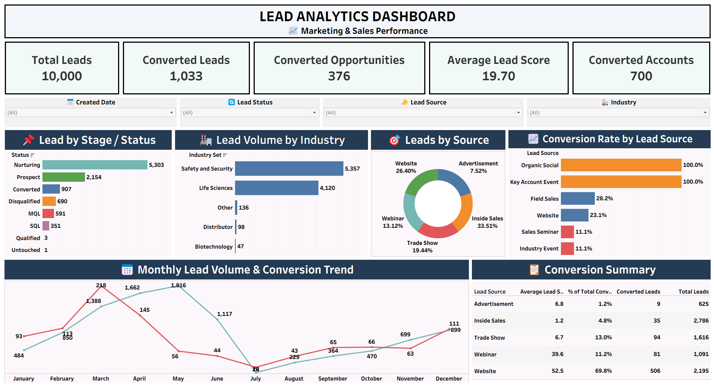
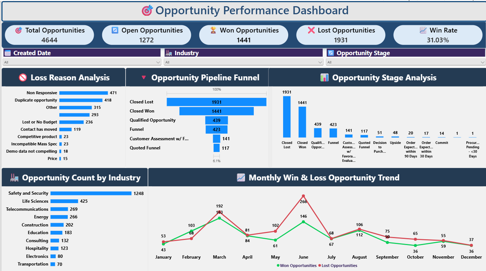

# CRM Analytics Project

## 📌 Project Overview

This project focuses on analyzing Customer Relationship Management (CRM) data to evaluate lead generation, lead conversion, opportunity performance, and sales pipeline effectiveness.

The project uses Excel, SQL, Power BI, and Tableau to transform CRM data into meaningful business insights and interactive dashboards.

## 🎯 Business Objectives

- Analyze overall lead generation and conversion performance.
- Identify the most effective lead sources.
- Understand lead distribution across different industries and stages.
- Evaluate opportunity pipeline performance.
- Analyze won and lost opportunities.
- Monitor monthly lead and opportunity trends.
- Support data-driven business decisions.

## 🛠️ Tools & Technologies

| Tool | Purpose |
|---|---|
| Microsoft Excel | Data cleaning and exploration |
| SQL | Data querying and analysis |
| Power BI | Interactive dashboard development |
| Tableau | Data visualization and reporting |

## 📂 Project Structure

```text
CRM-Analytics-Project/
│
├── Excel/
│   ├── CRM_Lead_Dataset.xlsx
│   └── CRM_Opportunity_Dataset.xlsx
│
├── SQL/
│   └── CRM_Analytics_Queries.sql
│
├── Power-BI/
│   └── CRM_Analytics_Dashboard.pbix
│
├── Tableau/
│   └── CRM_Analytics_Tableau.twbx
│
├── Screenshots/
│   ├── Power-BI/
│   │   ├── CRM_Lead_PowerBI.png
│   │   └── CRM_Opportunity_PowerBI.png
│   │
│   └── Tableau/
│       └── CRM_Lead_Tableau.png
│
└── README.md
```

## 📊 Dashboard 1: Lead Analytics Dashboard

**Objective:** Analyze lead generation, lead conversion, lead sources, industry distribution, and monthly lead trends.

### Key Performance Indicators

- Total Leads: 10,000
- Converted Leads: 1,033
- Lead Conversion Rate: 10.33%
- Converted Opportunities: 376
- Converted Accounts: 700
- Average Lead Score: 19.70

### Dashboard Visualizations

- Lead Pipeline by Stage
- Lead Source Distribution
- Lead Conversion Rate by Source
- Lead Distribution by Industry
- Monthly Lead Volume and Conversion Trend

### Power BI Dashboard



### Tableau Dashboard



## 📈 Dashboard 2: Opportunity Performance Dashboard

**Objective:** Evaluate opportunity pipeline performance, analyze win and loss outcomes, and understand opportunity distribution across industries.

### Key Performance Indicators

- Total Opportunities: 4,644
- Open Opportunities: 1,272
- Won Opportunities: 1,441
- Lost Opportunities: 1,931
- Win Rate: 31.03%

### Dashboard Visualizations

- Loss Reason Analysis
- Opportunity Pipeline Funnel
- Opportunity Stage Analysis
- Opportunity Count by Industry
- Monthly Win and Loss Opportunity Trend

### Power BI Dashboard



## 🔍 Key Business Analysis Areas

1. Lead generation and conversion performance.
2. Lead source effectiveness.
3. Industry-wise lead distribution.
4. Opportunity pipeline analysis.
5. Opportunity win and loss performance.
6. Monthly business performance trends.

## 💡 Business Value

This project demonstrates how CRM data can be analyzed and visualized to help marketing and sales teams:

- Monitor lead pipeline health.
- Identify effective lead generation channels.
- Understand opportunity performance.
- Track conversion and win rates.
- Make informed business decisions.

## 🚀 Project Deliverables

- Excel datasets
- SQL analysis scripts
- Power BI dashboards
- Tableau dashboard
- Dashboard screenshots and visualizations

## 👨‍💻 Skills Demonstrated

Excel | SQL | Data Cleaning | Data Analysis | Power BI | Tableau | Data Visualization | Dashboard Development | Business Intelligence
